<picture>
  <source media="(prefers-color-scheme: dark)" srcset="assets/banner-dark.svg">
  
</picture>

I'm an Information Security master's student at UNEC, specializing in the security of control-system software, and a Teaching Assistant at Holberton School Azerbaijan, where I completed the cybersecurity program. I founded Cyber Club UNEC, led it as president for two years, and now head its Digital Development and Cybersecurity department. I also build web platforms, including the club's own.

[LinkedIn](https://www.linkedin.com/in/elmar-jabbarov/) · [elmarcabbarov@proton.me](mailto:elmarcabbarov@proton.me) · [Cyber Club UNEC](https://github.com/Cyber-Club-UNEC)

## Experience and education

| | |
|---|---|
| **Teaching Assistant** | Holberton School Azerbaijan |
| **Founder, Cyber Club UNEC** | President for two years; now head of the Digital Development and Cybersecurity department |
| **MSc, Information Security** | UNEC, 2026–2028. Specialization: security of control-system software |
| **Cybersecurity program** | Holberton School Azerbaijan |
| **BSc, Computer Science** | UNEC, 2022–2026 |

## Projects

| Project | What it is | Stack |
|---|---|---|
| **[Qaraman](https://qaraman.az)** | Holberton capstone, live at qaraman.az. Public site with news, trainings and success stories, plus an admin panel for publishing content. Team project. | Next.js, next-intl, Fastify, Kysely |
| **Cyber Club UNEC platform** | Website and member area for the UNEC cybersecurity club: learning tracks, CTF hub, events and an admin CMS. *Private, in development.* | Next.js, Supabase, Tiptap, Zod |
| **[Holberton AZ live wallpapers](https://github.com/elmarcabbarov/holberton-az-wallpapers)** | 21 animated desktop wallpapers, 8 of them cybersecurity themed. Seamless 16-second loops rendered from canvas with Playwright and ffmpeg. | Canvas, JavaScript, Python |

## Security coursework

| Repository | Topics |
|---|---|
| [holbertonschool-cyber_security](https://github.com/elmarcabbarov/holbertonschool-cyber_security) | Linux and network security, web application security, Active Directory, Windows persistence, privilege escalation, vulnerability research, prompt injection |
| [holbertonschool-reverse_engineering](https://github.com/elmarcabbarov/holbertonschool-reverse_engineering) | RE fundamentals, static and dynamic analysis, malware analysis |
| [holbertonschool-mobile_Security](https://github.com/elmarcabbarov/holbertonschool-mobile_Security) | Static and dynamic analysis of mobile apps |
| [holberton-sprint2-exam](https://github.com/elmarcabbarov/holberton-sprint2-exam) | SQL injection, command injection, SSRF, IDOR, file upload, log analysis, Active Directory |
| [holberton-sprint3-project-and-task-explanation](https://github.com/elmarcabbarov/holberton-sprint3-project-and-task-explanation) | Write-ups: Linux and Windows privilege escalation |
| [network](https://github.com/elmarcabbarov/holbertonschool-network) · [system_engineering-devops](https://github.com/elmarcabbarov/holbertonschool-system_engineering-devops) · [shell](https://github.com/elmarcabbarov/holbertonschool-shell) | Networking, Linux and shell fundamentals |

## Tools

**Languages:** Python, Bash, TypeScript, JavaScript, SQL 
**Web:** Next.js, React, Fastify, Supabase 
**Environment:** Linux (Arch, Hyprland), Git, Docker
